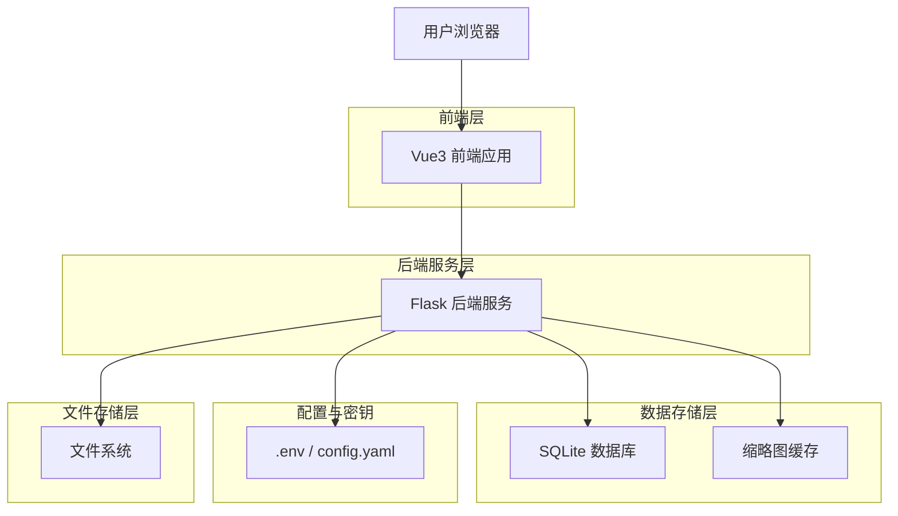
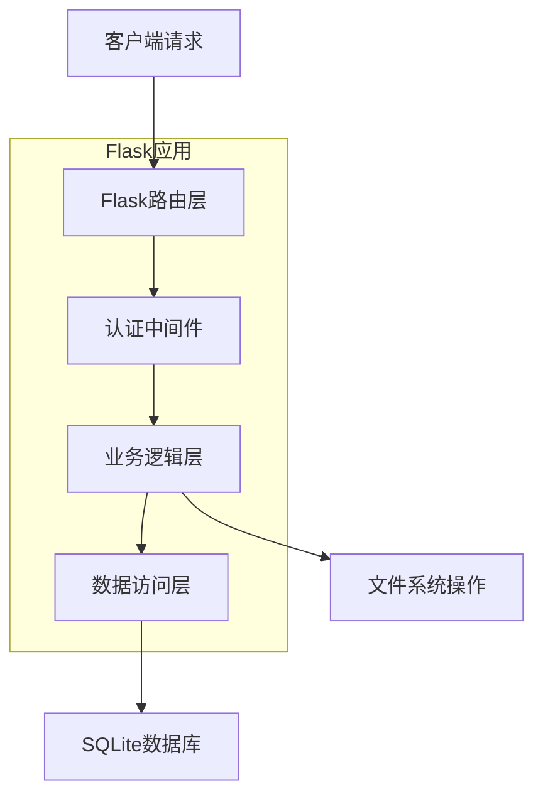
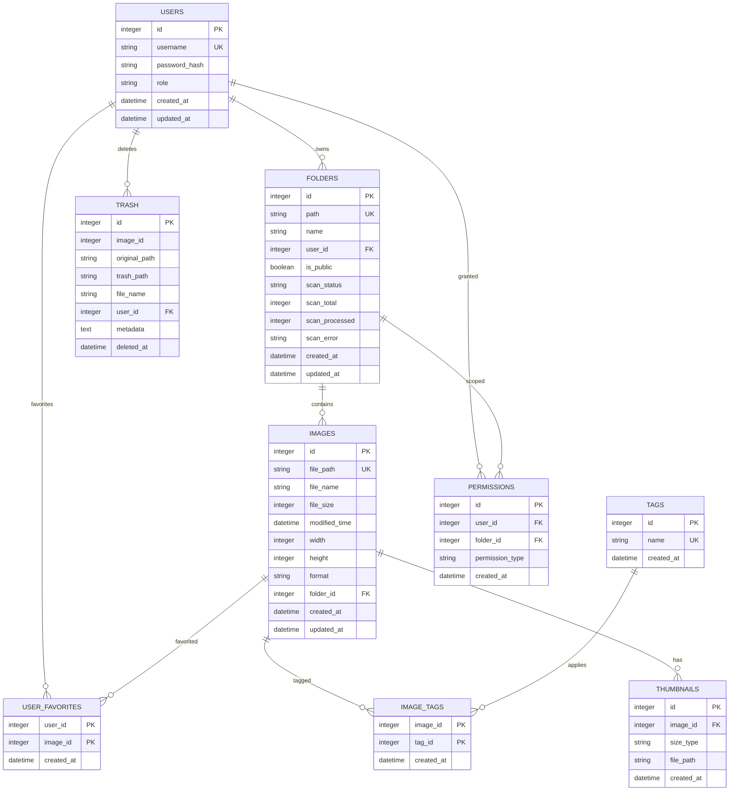
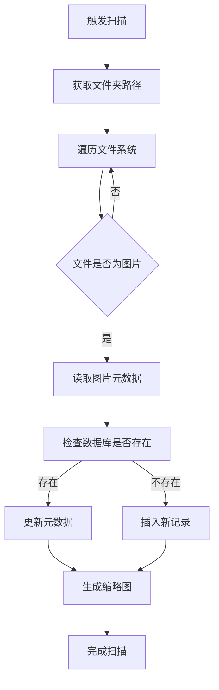
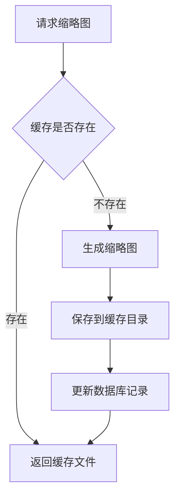

# PictureWeb 技术架构文档

## 1. 架构设计



## 2. 技术栈描述

- **前端**: Vue3 + Vite7 + Element Plus
- **初始化工具**: Vite
- **后端**: Python 3.12 + Flask 3（生产 Waitress）
- **数据库**: SQLite3
- **鉴权与配置**: `itsdangerous` 签名 Token（`SECRET_KEY` 来自未跟踪的 `.env`）；`python-dotenv` 加载 `.env`；`config.yaml` 只存非敏感运行配置
- **部署模式**: 非前后端分离，Flask托管静态资源

## 3. 路由定义

| 路由 | 用途 |
|------|------|
| / | 主页，显示图片瀑布流 |
| /about | 占位页面 |
| /login | 登录弹窗（非独立路由，由 Sidebar 控制） |
| /admin | 管理员面板（HomePage 内视图状态，非独立路由） |
| /api/* | API接口前缀 |

## 4. API接口定义

### 4.0 通用约定

- 基础前缀：`/api`
- 鉴权：`Authorization: Bearer <token>`；Token 由 `itsdangerous` 签名，`SECRET_KEY` 来自 `.env`，默认有效期 7 天
- 响应：JSON；错误统一为 `{"error": "..."}`，由 HTTP 状态码表达结果
- 分页：`page`（默认 1）、`per_page`（默认 50）
- 匿名访问：公开文件夹的读取接口允许无 Token；写操作和管理员接口要求登录
- 当前未实现独立的标签 CRUD 路由；标签表与关联表已存在，但接口能力有限

### 4.1 认证（`/api/auth`）

#### POST `/api/auth/login`

请求参数:
| 参数名 | 参数类型 | 是否必需 | 描述 |
|--------|----------|----------|------|
| username | string | 是 | 用户名 |
| password | string | 是 | 密码 |

响应参数:
| 参数名 | 参数类型 | 描述 |
|--------|----------|------|
| token | string | 签名 Token（`itsdangerous`，默认 7 天有效期，密钥来自 `.env`） |
| user | object | 用户信息对象 |
| user.id | integer | 用户 ID |
| user.username | string | 用户名 |
| user.role | string | 用户角色（admin / user / guest） |

#### GET `/api/auth/me`

- 权限：登录
- 响应：`{"user": {"id", "username", "role"}}`
- Token 缺失、被篡改或过期返回 401

### 4.2 文件夹管理（`/api/folders`）

| 方法 | 路径 | 权限 | 说明 |
|------|------|------|------|
| GET | `/api/folders` | 可选登录 | 管理员返回全部；登录用户返回公开文件夹 + 有 `read` 权限的文件夹；匿名仅返回公开文件夹 |
| POST | `/api/folders` | 登录（非 guest） | 添加文件夹并触发后台异步扫描；参数 `path`、可选 `name`、`is_public` |
| PATCH | `/api/folders/<id>` | 管理员 | 更新 `name`、`path`、`is_public` |
| DELETE | `/api/folders/<id>?hard=false` | 管理员 | 删除文件夹索引；`hard=true` 时先把物理目录移动到应用回收站 |
| POST | `/api/folders/<id>/scan` | 登录（非 guest） | 手动触发重新扫描，扫描中返回 409 |

文件夹对象包含 `scan_status`（none/pending/scanning/completed/failed）、`scan_total`、`scan_processed`、`scan_error`。

### 4.3 图片管理（`/api/images`）

| 方法 | 路径 | 权限 | 说明 |
|------|------|------|------|
| GET | `/api/images` | 可选登录 | 分页列表；支持 `folder_id`、`is_favorite`、`q`、`sort_by`（modified_time/file_name/file_size）、`sort_order` |
| GET | `/api/images/<id>` | 可选登录 | 图片详情，附带当前用户收藏状态 `is_favorite` |
| PATCH | `/api/images/<id>` | 登录（非 guest） | 重命名（`file_name`）或调整所属文件夹（`folder_id`） |
| POST | `/api/images/<id>/favorite` | 登录（非 guest） | 切换当前用户收藏状态 |
| GET | `/api/images/<id>/thumbnail?size=small\|medium` | 公开 | 读取缩略图（按需生成并缓存） |
| GET | `/api/images/<id>/raw` | 公开 | 读取原图 |
| GET | `/api/images/<id>/download` | 公开 | 以附件形式下载原图 |
| POST | `/api/images/batch/move` | 登录（非 guest） | 批量移动；参数 `image_ids`、`target_folder_id` |
| POST | `/api/images/batch/delete` | 登录（非 guest） | 批量移动到应用内回收站并记录元数据 |

> 已知安全缺口：`raw`、`thumbnail`、`download` 当前未校验登录与文件夹权限，对外暴露前需补齐。

### 4.4 回收站（`/api/images/trash`）

| 方法 | 路径 | 权限 | 说明 |
|------|------|------|------|
| GET | `/api/images/trash/items` | 登录 | 管理员查看全部；普通用户仅查看自己的回收站记录 |
| GET | `/api/images/trash/<id>/thumbnail` | 登录（所有者/管理员） | 读取回收站文件缩略图 |
| POST | `/api/images/trash/restore` | 登录（所有者/管理员） | 批量恢复；参数 `trash_ids` |
| POST | `/api/images/trash/clear` | 登录（所有者/管理员） | 彻底删除指定记录；`trash_ids` 为空时清空当前用户回收站 |

### 4.5 管理接口（`/api/admin`）

所有 `/api/admin/*` 接口在 Blueprint `before_request` 中要求 `admin` 角色。

| 方法 | 路径 | 说明 |
|------|------|------|
| GET | `/api/admin/cache/stats` | 缓存目录大小与路径 |
| POST | `/api/admin/cache/clear` | 清空缩略图缓存与 `thumbnails` 表 |
| GET / POST | `/api/admin/users` | 用户列表 / 新增用户 |
| PATCH / DELETE | `/api/admin/users/<id>` | 修改角色或密码 / 删除用户（保护配置管理员、guest 与最后一个管理员） |
| GET | `/api/admin/folders` | 全部文件夹 |
| DELETE | `/api/admin/folders/<id>` | 删除文件夹及其图片索引（不移动物理目录） |
| GET / POST | `/api/admin/permissions` | 权限列表 / 批量新增权限 |
| DELETE | `/api/admin/permissions/<id>` | 删除权限 |
| GET / POST | `/api/admin/settings` | 读取 / 更新 `config.yaml`（不包含 `.env` 密钥） |

### 4.6 健康检查

| 方法 | 路径 | 权限 | 说明 |
|------|------|------|------|
| GET | `/api/health` | 公开 | 返回 `{"status": "ok"}` |

## 5. 服务器架构图



## 6. 数据模型

### 6.1 数据模型定义



### 6.2 数据定义语言

> 以下结构与 `server/app/models/schema.sql` 保持一致；实际建表语句使用 `CREATE TABLE IF NOT EXISTS`，并包含对应索引。

#### 用户表 (users)
```sql
CREATE TABLE users (
    id INTEGER PRIMARY KEY AUTOINCREMENT,
    username VARCHAR(50) UNIQUE NOT NULL,
    password_hash VARCHAR(255) NOT NULL,
    role VARCHAR(20) DEFAULT 'user' CHECK (role IN ('admin', 'user', 'guest')),
    created_at TIMESTAMP DEFAULT CURRENT_TIMESTAMP,
    updated_at TIMESTAMP DEFAULT CURRENT_TIMESTAMP
);

CREATE INDEX idx_users_username ON users(username);
```

#### 文件夹表 (folders)
```sql
CREATE TABLE folders (
    id INTEGER PRIMARY KEY AUTOINCREMENT,
    path TEXT UNIQUE NOT NULL,
    name VARCHAR(255) NOT NULL,
    user_id INTEGER,
    is_public BOOLEAN DEFAULT FALSE,
    scan_status VARCHAR(20) DEFAULT 'none' CHECK (scan_status IN ('none', 'pending', 'scanning', 'completed', 'failed')),
    scan_total INTEGER DEFAULT 0,
    scan_processed INTEGER DEFAULT 0,
    scan_error TEXT,
    created_at TIMESTAMP DEFAULT CURRENT_TIMESTAMP,
    updated_at TIMESTAMP DEFAULT CURRENT_TIMESTAMP,
    FOREIGN KEY (user_id) REFERENCES users(id)
);

CREATE INDEX idx_folders_path ON folders(path);
CREATE INDEX idx_folders_user_id ON folders(user_id);
```

#### 图片表 (images)
```sql
CREATE TABLE images (
    id INTEGER PRIMARY KEY AUTOINCREMENT,
    file_path TEXT UNIQUE NOT NULL,
    file_name VARCHAR(255) NOT NULL,
    file_size INTEGER,
    modified_time TIMESTAMP,
    width INTEGER,
    height INTEGER,
    format VARCHAR(10),
    folder_id INTEGER,
    created_at TIMESTAMP DEFAULT CURRENT_TIMESTAMP,
    updated_at TIMESTAMP DEFAULT CURRENT_TIMESTAMP,
    FOREIGN KEY (folder_id) REFERENCES folders(id)
);

CREATE INDEX idx_images_file_path ON images(file_path);
CREATE INDEX idx_images_folder_id ON images(folder_id);
CREATE INDEX idx_images_modified_time ON images(modified_time);
```

#### 用户收藏表 (user_favorites)
```sql
CREATE TABLE user_favorites (
    user_id INTEGER NOT NULL,
    image_id INTEGER NOT NULL,
    created_at TIMESTAMP DEFAULT CURRENT_TIMESTAMP,
    PRIMARY KEY (user_id, image_id),
    FOREIGN KEY (user_id) REFERENCES users(id) ON DELETE CASCADE,
    FOREIGN KEY (image_id) REFERENCES images(id) ON DELETE CASCADE
);

CREATE INDEX idx_user_favorites_user_id ON user_favorites(user_id);
CREATE INDEX idx_user_favorites_image_id ON user_favorites(image_id);
```

#### 标签表 (tags)
```sql
CREATE TABLE tags (
    id INTEGER PRIMARY KEY AUTOINCREMENT,
    name VARCHAR(50) UNIQUE NOT NULL,
    created_at TIMESTAMP DEFAULT CURRENT_TIMESTAMP
);
```

#### 图片标签关联表 (image_tags)
```sql
CREATE TABLE image_tags (
    image_id INTEGER,
    tag_id INTEGER,
    created_at TIMESTAMP DEFAULT CURRENT_TIMESTAMP,
    PRIMARY KEY (image_id, tag_id),
    FOREIGN KEY (image_id) REFERENCES images(id) ON DELETE CASCADE,
    FOREIGN KEY (tag_id) REFERENCES tags(id) ON DELETE CASCADE
);
```

#### 缩略图表 (thumbnails)
```sql
CREATE TABLE thumbnails (
    id INTEGER PRIMARY KEY AUTOINCREMENT,
    image_id INTEGER NOT NULL,
    size_type VARCHAR(20) NOT NULL,
    file_path TEXT NOT NULL,
    created_at TIMESTAMP DEFAULT CURRENT_TIMESTAMP,
    FOREIGN KEY (image_id) REFERENCES images(id) ON DELETE CASCADE,
    UNIQUE(image_id, size_type)
);

CREATE INDEX idx_thumbnails_image_id ON thumbnails(image_id);
```

#### 权限表 (permissions)
```sql
CREATE TABLE permissions (
    id INTEGER PRIMARY KEY AUTOINCREMENT,
    user_id INTEGER NOT NULL,
    folder_id INTEGER NOT NULL,
    permission_type VARCHAR(20) NOT NULL CHECK (permission_type IN ('read', 'write', 'delete', 'rename')),
    created_at TIMESTAMP DEFAULT CURRENT_TIMESTAMP,
    FOREIGN KEY (user_id) REFERENCES users(id) ON DELETE CASCADE,
    FOREIGN KEY (folder_id) REFERENCES folders(id) ON DELETE CASCADE,
    UNIQUE(user_id, folder_id, permission_type)
);
```

#### 回收站表 (trash)
```sql
CREATE TABLE trash (
    id INTEGER PRIMARY KEY AUTOINCREMENT,
    image_id INTEGER,
    original_path TEXT NOT NULL,
    trash_path TEXT NOT NULL,
    file_name VARCHAR(255) NOT NULL,
    user_id INTEGER NOT NULL,
    metadata TEXT,
    deleted_at TIMESTAMP DEFAULT CURRENT_TIMESTAMP,
    FOREIGN KEY (user_id) REFERENCES users(id) ON DELETE CASCADE
);

CREATE INDEX idx_trash_user_id ON trash(user_id);
CREATE INDEX idx_trash_deleted_at ON trash(deleted_at);
```

## 7. 前端架构

### 7.1 组件层次结构

```
web/src/
├── api/
│   └── index.ts             # axios 封装、Token 注入、401 凭证清理
├── components/
│   ├── Sidebar.vue          # 侧边栏（文件夹/收藏/回收站/管理/登录）
│   ├── TopBar.vue           # 顶部搜索与主题切换
│   ├── ImageGrid.vue        # 图片网格与批量操作
│   ├── Lightbox.vue         # 图片详情灯箱
│   ├── Empty.vue            # 空状态占位
│   └── common/
│       └── VirtualWaterfall.vue  # 虚拟滚动瀑布流
├── composables/
│   └── useTheme.ts          # 明暗主题
├── lib/
│   └── utils.ts             # class 合并工具
├── pages/
│   ├── HomePage.vue         # 主视图（瀑布流/管理/回收站切换）
│   ├── AdminPage.vue        # 管理面板
│   └── TrashPage.vue        # 回收站
├── router/
│   └── index.ts             # / 与 /about
├── stores/
│   ├── auth.ts              # 登录状态与 401 重置
│   ├── folder.ts            # 文件夹列表与当前选择
│   ├── image.ts             # 图片/回收站/批量操作
│   ├── hotkey.ts            # 快捷键配置
│   └── ui.ts                # 侧边栏与响应式状态
├── App.vue
├── main.ts
└── style.css
```

### 7.2 状态管理

使用 Pinia 进行状态管理：

- **authStore**：管理用户登录状态、Token 与角色；Token 失效时由 API 层事件触发重置
- **imageStore**：管理图片数据、分页、加载状态、筛选条件、批量操作与回收站
- **folderStore**：管理文件夹结构、当前选中文件夹
- **hotkeyStore**：从 `/api/admin/settings` 读取快捷键配置
- **uiStore**：管理侧边栏折叠与移动端响应式状态

## 8. 核心逻辑流程

### 8.1 图片扫描流程



### 8.2 缩略图生成流程



## 9. 目录结构

> 2026-10-24 按仓库现状核对修正：原文档中的 `backend/`、`frontend/` 为规划名，实际目录为 `server/`、`web/`；同日完成目录整理、测试/生产库分离与 `.env` 凭证外置。版本、端口与启动方式的权威记录见 `docs/tech/dev-info.md`。

```
PicGallery/
├── server/                      # Flask 后端
│   ├── app/
│   │   ├── __init__.py          # create_app、.env/config 加载、蓝图注册、web/dist 静态托管
│   │   ├── models/schema.sql    # 建表语句
│   │   ├── routes/              # auth.py / folder.py / image.py / admin.py
│   │   ├── services/            # scanner.py（扫描）/ thumbnail.py（缩略图）
│   │   └── utils/db.py          # 连接、建表、轻量迁移、管理员/访客初始化
│   ├── venv/                    # Python 3.12.7 虚拟环境（git 忽略）
│   ├── requirements.txt         # Python 依赖
│   └── run.py                   # 开发入口（Flask dev server）
├── web/                         # Vue3 + Vite 前端
│   ├── src/
│   │   ├── api/                 # axios 封装与 401 清理
│   │   ├── components/          # Sidebar/TopBar/ImageGrid/Lightbox/common
│   │   ├── composables/         # useTheme
│   │   ├── pages/               # HomePage/AdminPage/TrashPage
│   │   ├── router/              # 路由
│   │   ├── stores/              # Pinia：auth/folder/image/hotkey/ui
│   │   ├── lib/                 # 工具函数
│   │   ├── App.vue
│   │   ├── main.ts
│   │   └── style.css
│   ├── public/                  # favicon、MiSans 字体
│   ├── dist/                    # 构建产物（git 忽略，生产静态资源）
│   ├── package.json
│   ├── tsconfig.json
│   └── vite.config.ts           # 别名 @ 与 /api 代理
├── docs/                        # prd/tech/plan/deploy/rules/prototype
├── scripts/
│   ├── deploy-script/           # Windows 部署脚本
│   └── sql-script/              # init_db.py / normalize_db.py
├── data/                        # 本地运行数据（git 忽略）
│   ├── db/database.db           # 开发/测试数据库
│   ├── cache/                   # 缩略图缓存
│   ├── trash/                   # 应用内回收站
│   └── app_logs/                # 本地日志
├── config.yaml                  # 非敏感运行配置（开发/测试）
├── config.example.yaml          # 配置示例
├── .env.example                 # 密钥与管理员初始账号示例（真实 .env 不入库）
├── prod_run.py                  # 生产入口（Waitress）
└── README.md
```

## 10. 性能优化策略

### 10.1 数据库优化
- 使用合适的索引策略
- 定期VACUUM清理数据库
- 使用预编译语句

### 10.2 前端优化
- 虚拟滚动技术
- 图片懒加载
- 防抖节流处理

### 10.3 后端优化
- 异步处理扫描任务
- 连接池管理
- 缓存策略